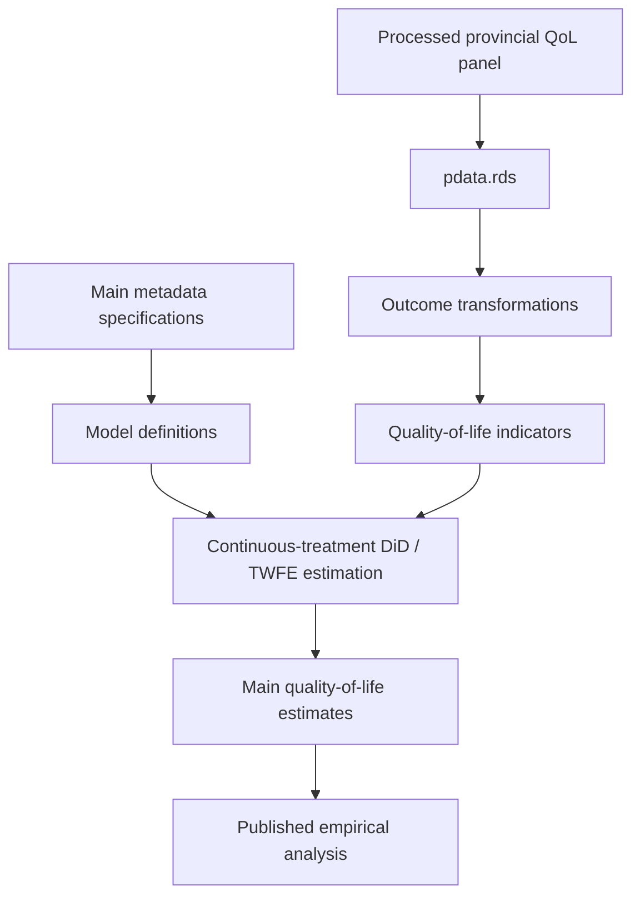

# Digital Infrastructure and Quality of Life — Replication Package

**Published in:** *Socio-Economic Planning Sciences* (Elsevier), Volume 106, Article 102545, 2026.

**DOI:** https://doi.org/10.1016/j.seps.2026.102545

**Published article:** https://www.sciencedirect.com/science/article/pii/S0038012126001321

**Authors:** Angela Stefania Bergantino, Benedetta Coluccia, Giulio Fusco, Gianluca Monturano.

**Repository:** https://github.com/gmonturano/Digital_and_quality_of_life

---

<p align="center">
  
</p>

## About this replication package

This repository accompanies the research article:

**Digital infrastructure and territorial heterogeneity in quality-of-life outcomes.**

The public repository provides the **main econometric estimation code**, associated metadata, and supporting processed data.

The package focuses on the principal fixed-effects estimations used to examine the effects of rural broadband diffusion on quality-of-life outcomes.

It does not constitute the complete archive of all data-processing, index-construction, spatial-analysis, and robustness procedures associated with the study.

**The full replication package may be requested directly from the corresponding author by email**, subject to applicable data-sharing restrictions.

---

## 1. Overview

The study examines how the expansion of digital infrastructure affects quality of life across Italian provinces.

The analysis uses provincial panel data covering **2014–2022** and exploits the policy-driven expansion of ultra-fast broadband networks in rural areas.

Rather than considering economic growth alone, the paper investigates the multidimensional consequences of digital infrastructure.

Four principal quality-of-life dimensions are examined:

- Economic well-being and income.
- Education.
- Environmental conditions.
- Health outcomes.

A composite quality-of-life index is also considered in the published study.

The main econometric framework uses a continuous-treatment Difference-in-Differences approach with fixed effects.

The research investigates whether broadband expansion produces consistent improvements across different dimensions or instead generates territorial trade-offs.

The published paper also includes analyses of spatial heterogeneity.

The public repository focuses on the main metadata-driven estimation procedures.

---

## 2. Scope of public replication

The publicly available repository contains:

- The main R estimation script.
- Supporting estimation functions.
- The metadata workbook for the main specification group.
- A processed provincial panel in RDS format.
- Documentation of the principal estimation framework.

The broader research workflow includes additional procedures such as:

- Construction of individual quality-of-life indicators.
- Harmonization of socioeconomic and infrastructure data.
- Construction of composite quality-of-life measures.
- Spatial and territorial heterogeneity analyses.
- Alternative specifications.
- Robustness and sensitivity checks.

These additional components are not necessarily included in the minimal public repository.

Researchers requiring the complete computational materials should request the full replication package directly from the corresponding author.

---

## 3. Replication workflow



The workflow summarizes the estimation procedures contained in the public package.

It does not represent the complete construction of all indicators and spatial analyses reported in the article.

---

## 4. Repository structure

```text
Digital_and_quality_of_life/
│
├── code/
│   ├── 00_functions.R
│   ├── 01_main_estimation.R
│   └── meta_fusco.xlsx
│
├── db/
│   └── pdata.rds
│
├── cover.png
├── .gitignore
└── README.md
```

The public repository separates the main R estimation code, metadata, and processed research panel.

---

## 5. Data availability

The empirical analysis draws on information concerning:

- Rural broadband infrastructure.
- Income and economic well-being.
- Educational outcomes.
- Environmental quality.
- Health indicators.
- Provincial socioeconomic characteristics.
- Time-varying controls.

### 5.1 Processed estimation dataset

The repository includes:

```text
db/pdata.rds
```

The file contains the processed panel read by the public estimation script.

It supports the implementation of the main specifications contained in the repository's metadata workbook.

The data are organized by province and year.

### 5.2 Data transformations

The public R script implements selected transformations required by the estimation framework.

These include logarithmic transformations of relevant environmental and tourism-related variables where such columns are available.

The complete preparation of all variables and the construction of the multidimensional quality-of-life indicators may require additional research materials.

### 5.3 Replication limitations

The processed dataset and main estimation script allow inspection of the central modeling procedures.

They should not be interpreted as a guarantee of complete reproduction of every published table, figure, composite indicator, or supplementary analysis.

Exact reproduction of the complete research workflow may require additional code and underlying data sources.

---

## 6. Metadata and econometric specifications

The public estimation script uses:

```text
code/meta_fusco.xlsx
```

The metadata workbook was originally shared with the related research on broadband infrastructure and income inequality.

However, the two research projects use **different specification worksheets**.

For this paper, the relevant main specification group originates from **worksheet 7 (`Foglio1`)** of the original metadata workbook.

The version distributed with this repository contains the selected worksheet as its only worksheet.

Consequently, the public script reads the local metadata file directly without requiring the complete multi-sheet source workbook.

The metadata identify the main:

- Quality-of-life outcomes.
- Broadband treatment variables.
- Control variables.
- Fixed-effects specifications.
- Alternative model configurations.

The central estimation structure can be summarized as:

```text
QoL_it =
    BroadbandTreatment_it
    + SocioeconomicControls_it
    + Province fixed effects
    + Year fixed effects
    + Error_it
```

The exact transformations, variables, and estimation equations are determined by the R code and accompanying metadata.

---

## 7. Main R scripts

### `code/00_functions.R`

Provides auxiliary functions used for:

- Reading metadata-defined specifications.
- Organizing model formulas.
- Running fixed-effects estimations.
- Managing the estimation objects.

### `code/01_main_estimation.R`

Implements the principal public estimation procedure for quality-of-life outcomes.

The script:

1. Loads the processed dataset from `pdata.rds`.
2. Converts the panel time identifier where required.
3. Applies selected variable transformations.
4. Reads the main metadata workbook.
5. Executes the metadata-driven fixed-effects models.

The script focuses on the principal estimation specifications.

It does not include the entire collection of spatial, composite-index, and additional robustness analyses reported in the article.

---

## 8. Software requirements

The empirical analysis was developed in **R**.

The scripts rely on packages supporting:

- Panel-data analysis.
- Fixed-effects estimation.
- Excel metadata import.
- Data management and transformations.
- Statistical reporting.

Users should install the dependencies referenced in the supplied scripts.

RStudio is recommended but not required.

---

## 9. How to run

Clone the repository:

```bash
git clone https://github.com/gmonturano/Digital_and_quality_of_life.git
```

Open the repository root in R or RStudio.

Run the main estimation script:

```r
source("code/01_main_estimation.R")
```

The script reads:

```text
db/pdata.rds
code/meta_fusco.xlsx
```

The main panel identifiers are:

```text
Provincia
Anno
```

The metadata-driven estimation procedure constructs model objects for the selected quality-of-life specifications.

Successful execution requires the necessary R packages and compatibility between the processed data and the model definitions.

---

## 10. Replication outputs

Depending on the metadata-defined specification, the code can produce:

- Estimated broadband-treatment coefficients.
- Standard errors.
- Fixed-effects regression summaries.
- Model-level statistical information.

The public estimation procedures address the principal quality-of-life models.

The published article remains the authoritative source for the results, including the composite index, spatial evidence, and supplementary robustness analyses.

---

## 11. Full replication package — available upon request

**The present repository provides the public main-estimation code and supporting data, not the complete replication archive.**

The complete research archive may include:

- Original source-data integration.
- Construction of quality-of-life indicators.
- Composite index construction.
- Spatial and local treatment-effect analyses.
- Additional model specifications.
- Robustness and sensitivity analyses.
- Supplementary figures and tables.

**Researchers who wish to obtain the full replication package should contact the corresponding author directly by email.**

Please identify the article by its title or DOI and briefly describe the research or replication purpose.

Access to specific materials remains subject to applicable data-sharing, licensing, and confidentiality conditions.

---

## 12. Citation

If you use the public code, metadata, or supporting materials, please cite:

Bergantino, A. S., Coluccia, B., Fusco, G., & Monturano, G. (2026).

**Digital infrastructure and territorial heterogeneity in quality-of-life outcomes.**

*Socio-Economic Planning Sciences, 106*, 102545.

https://doi.org/10.1016/j.seps.2026.102545

### BibTeX

```bibtex
@article{bergantino2026quality,
  title   = {Digital infrastructure and territorial heterogeneity
             in quality-of-life outcomes},
  author  = {Bergantino, Angela Stefania and
             Coluccia, Benedetta and
             Fusco, Giulio and
             Monturano, Gianluca},
  journal = {Socio-Economic Planning Sciences},
  volume  = {106},
  pages   = {102545},
  year    = {2026},
  doi     = {10.1016/j.seps.2026.102545},
  url     = {https://doi.org/10.1016/j.seps.2026.102545}
}
```

---

## 13. Contact and research inquiries

For questions regarding the main estimation code, model metadata, or full replication materials, please contact the corresponding author directly by email.

**Repository scope:** Public main-estimation code and processed supporting panel.

**Full replication package:** Available upon direct email request, subject to applicable restrictions.

**Official publication:** https://doi.org/10.1016/j.seps.2026.102545
