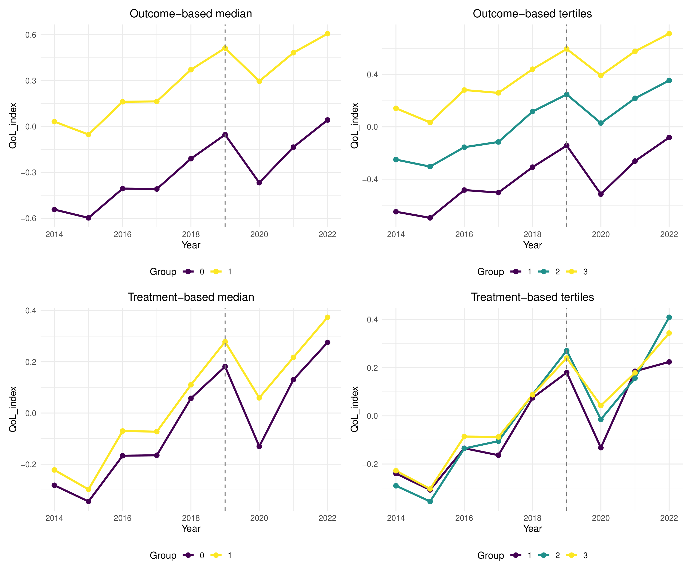
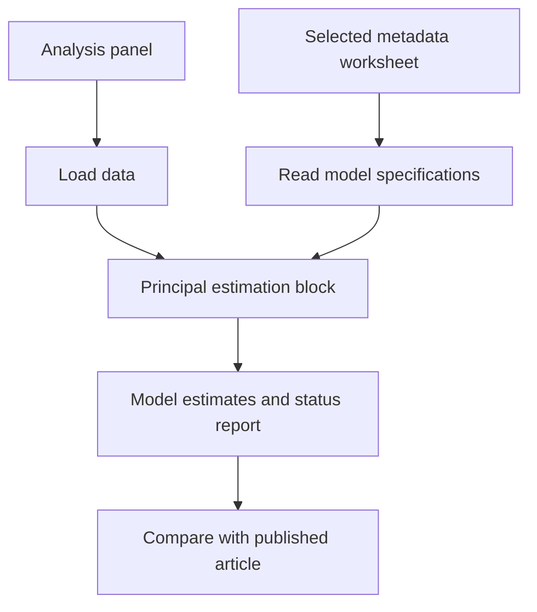

# Digital Infrastructure and Quality of Life — Replication Package

<p align="center">
  
</p>

Research article: **Digital infrastructure and territorial heterogeneity in quality-of-life outcomes**


**Repository:** https://github.com/gmonturano/Digital_and_quality_of_life

## Overview

The project studies how digital infrastructure relates to heterogeneous quality-of-life outcomes. The analysis uses sheet 7 (Foglio1) of the author-provided meta_fusco workbook and the RDS panel used in the QoL code.

This repository provides the principal econometric source file, the metadata needed to identify the main specifications, the associated data material where redistribution is permitted, and a representative cover figure. Additional auxiliary scripts may be obtained from the authors on request.

## Main estimation design

**Two-way fixed-effects models specified in the seventh (Foglio1) metadata sheet.** The selected worksheet is copied from the original author-provided metadata workbook. The original worksheet name is preserved. No robustness or auxiliary worksheet is included.

## Replication workflow



## Repository structure

```text
README.md
cover.png
code/
  00_functions.R
  01_main_estimation.R
  meta_fusco.xlsx
db/
  pdata.rds
```

## Data and metadata

- **Database:** `db/pdata.rds`. Provincial panel in RDS format, referenced by the original QoL analysis scripts.
- **Metadata:** `code/meta_fusco.xlsx`, containing only the worksheet **Foglio1**.

The selected metadata specifications can be evaluated against the supplied processed panel; any missing variables and failed models are reported in `results/model_status.csv`. This package does not claim to reconstruct the entire original preprocessing pipeline.

## Main R scripts

- `code/01_main_estimation.R`: principal documented estimation entry point.
- `code/00_functions.R`: shared metadata parsing, variable checks, estimation, and machine-readable export.

## How to run

From the project root in R or RStudio, install the required R packages and execute:

```r
source("code/01_main_estimation.R")
```

Dependencies: **readxl, plm** (plus base R).

## Outputs

When estimation is feasible, scripts write CSV outputs to `results/`. For metadata-based TWFE models, an accompanying `model_status.csv` indicates which specifications were estimated and which could not be run using the supplied inputs.

Published coefficients and standard errors are documented in the article; they are not guaranteed to be reconstructed from public demonstration inputs.

## Figure

`cover.png` is the representative illustration supplied for this paper. It is displayed at the beginning of this README using a repository-relative path.

## Code availability

The main publicly shareable source files are included here. **The full set of coding files and supplementary implementation details is available from the authors upon reasonable request**, subject to applicable confidentiality and data-sharing restrictions.
